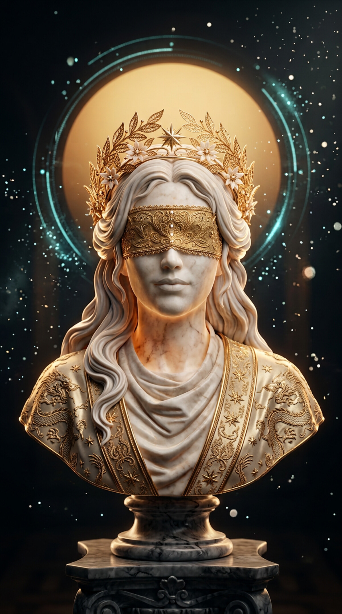

# Lyra Agentic OS

> **Empat harness. Satu jiwa.** / *Four harnesses. One soul.*

Lyra Agentic OS adalah eksplorasi sistem operasi agentic: satu harness terintegrasi tempat
**Claude Code** (Anthropic), **Antigravity** (Google), **Hermes** (Nous Research), dan **Codex** (OpenAI)
bekerja bersama — saling menyerahkan tugas, memverifikasi satu sama lain, dan berbagi satu memori.

Situs + konsol interaktif ini adalah **v0.1 "Aurea"**: lapisan visual, narasi produk, dan konsol
simulasi yang menunjukkan bagaimana orkestrasi 4-harness itu *terasa*.



---

## Isi v0.1

| Bagian | Deskripsi |
| --- | --- |
| **Landing sinematik** | Scene 3D real-time: patung Lyra holografik, cincin orbit, empat harness mengelilingi core. |
| **Konsol Lyra** (`/console`) | UI bergaya OS: composer niat, rencana misi, log orkestrasi, panel langkah, command palette. |
| **Mesin simulasi** | 4 misi deterministik (Code, Deeper Analysis, Cyber, Everyday) dengan handoff, artefak, dan gerbang persetujuan manusia. |
| **Bilingual** | Seluruh konten ID ⇄ EN, tersimpan di preferensi. |
| **Dokumentasi arsitektur** | 5 lapis sistem, kontrak misi, Memory Fabric, Policy Gate. |

> Konsol adalah **simulasi lokal**. Tidak ada perintah yang dijalankan di mesinmu.

---

## Menjalankan

```bash
npm install
npm run dev        # http://localhost:3000
npm run build      # build produksi
npm run typecheck  # TypeScript strict
```

Stack: **Next.js 16 (Turbopack) · React 19 · TypeScript · Tailwind CSS 4 ·
React Three Fiber + drei + postprocessing · zustand**.

---

## Struktur

```
app/
  page.tsx              # landing sinematik
  console/page.tsx      # konsol OS (6 panel: console, missions, graph, artifacts, memory, policy)
  globals.css           # design tokens (emas/ivory/obsidian), tekstur, animasi
components/
  three/                # LyraScene (R3F), LabelSprite
  site/                 # Hero, HarnessGrid, Architecture, Capabilities, LiveDemo, Safety, Roadmap, Footer
  ui/primitives.tsx     # SectionHeader, GoldButton, Pill, Divider
lib/
  harnesses.ts          # profil 4 harness + mode penalaran
  missions.ts           # skrip misi (langkah, handoff, artefak, gate)
  mission-store.ts      # state machine misi (zustand)
  use-runner.ts         # penggerak waktu simulasi
  i18n.ts               # kamus ID/EN
  locale-store.ts       # preferensi bahasa
```

---

## Arsitektur produk (yang digambarkan UI)

```
Permukaan      Desktop · CLI · Web Console
               ↓
Lyra Core      Intent Compiler · Mission Router · Memory Fabric · Policy Gate · Artifact Ledger
               ↓
Protokol       Kontrak tugas · Handoff · Cross-verify · Resolusi konflik
               ↓
Adapter        claude-code · antigravity · hermes · codex   (MCP / ACP / SDK)
               ↓
Sumber daya    Model · Tool · MCP server · Sandbox · Vault
```

Prinsip yang tidak ditawar:

1. **Satu bahasa kerja** — semua harness berbicara lewat protokol misi terbuka.
2. **Satu memori** — fakta & keputusan dibaca semua, ditulis tak diam-diam.
3. **Satu bukti** — klaim tanpa artefak ditolak verifier.
4. **Manusia tetap pemegang keputusan** — gerbang persetujuan per langkah berisiko.

---

## Roadmap

- **v0.1 Aurea** — design system, narasi, konsol simulasi *(sekarang)*
- **v0.2 Bridge** — adapter CLI nyata untuk 4 harness, Memory Fabric lokal, Artifact Ledger
- **v0.3 Orchestra** — Mission Router, verifikasi silang, negosiasi konflik, policy gate
- **v1.0 Lyra** — aplikasi desktop + CLI resmi, satu state banyak permukaan

---

## Identitas karakter

Visual Lyra: patung marmer-emas dengan blindfold emas — *yang melihat tanpa mata*.
Aset berada di `public/assets/lyra-*.{webp,jpg}` dan disajikan sebagai holografi di scene 3D.

---

## Catatan

Proyek eksplorasi independen. Claude Code milik Anthropic, Antigravity milik Google,
Hermes milik Nous Research, Codex milik OpenAI. Tidak berafiliasi dengan mereka.
Nama dan visual Lyra milik pembuat proyek.
