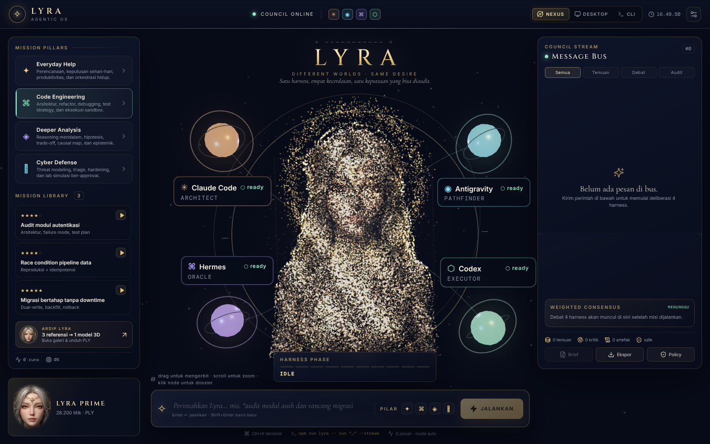
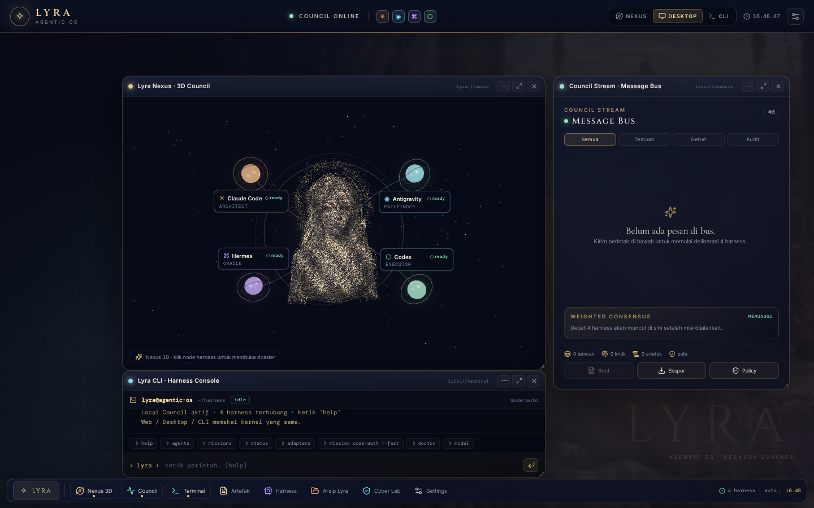

# ✧ Lyra Agentic OS

> **Different Worlds · Same Desire · One Harness**
>
> Sebuah Agentic OS 3D-interaktif tempat **Claude Code** (Anthropic), **Antigravity** (Google), **Hermes** (Nous Research), dan **Codex** (OpenAI) benar-benar berunding di satu harness terintegrasi — lengkap dengan surface **Web 3D**, **Desktop**, dan **CLI**.



---

## Apa yang sudah hidup

| Bidang | Isi |
|---|---|
| **Nexus 3D** | Rekonstruksi Lyra sebagai *point-cloud* 28.200 titik + bas-relief displacement + sigil berputar, 4 node harness yang bisa diklik, energy link berdenyut mengikuti message bus, orbit/zoom, starfield. |
| **Harness nyata** | `MessageBus` (correlation id, provenance, 8 channel) → `Blackboard` (facts/artifacts/decisions/votes/risk) → `Orchestrator` 10 fase → debate → **weighted consensus** → sintesis + 3 artefak (Brief MD / Checklist / Trace JSON). |
| **4 pilar** | Everyday Help · Code Engineering · Deeper Analysis · Cyber Defense, masing-masing 3 preset misi (12 total) dengan reasoning yang benar-benar diturunkan dari teks prompt. |
| **3 surface, 1 kernel** | Website (Nexus), Desktop shell (window manager + taskbar + 8 aplikasi), CLI (terminal in-browser **dan** `npm run lyra` Node asli). Ketiganya memanggil kelas `LyraOS` yang sama. |
| **Adapter siap** | `claude -p`, `ag run`, `hermes reason`, `codex exec` — aktif otomatis bila binary+env ada; gagal → fallback deterministik + catatan audit. Tanpa kunci API pun OS berjalan penuh. |
| **Cyber aman** | Defensif (STRIDE, triage, hardening) **+** lab simulasi tabletop yang hanya jalan pada `lab.local`/dummy scope dengan persetujuan eksplisit, redaksi IP/domain otomatis, dan audit trail. |
| **Karakter Lyra** | 3 referensi pengguna → `Lyra Prime` → model 3D (`.ply` bisa diunduh) + avatar + arsip galeri. Palet midnight-blue / champagne-gold / rose-petal. |

---

## Quickstart

```bash
npm install
npm run dev            # http://localhost:5173 · preview 3D
npm run build          # type-check + production bundle
npm run model          # rebuild aset 3D Lyra dari gambar (butuh pillow + numpy)
```

CLI yang **benar-benar sama kernelnya**:

```bash
npm run lyra -- help
npm run lyra -- agents
npm run lyra -- run "audit modul auth dan rancang migrasi tanpa downtime" --pillar=code --stream
npm run lyra -- mission cyber-threat-model --fast
npm run lyra -- doctor
npm run lyra            # REPL interaktif
```

Aktifkan adapter asli (opsional):

```bash
cp .env.example .env.local     # isi hanya di mesin lokal, jangan commit
npm run lyra -- set mode live
npm run lyra -- adapters
```

Desktop native (opsional, lihat [`desktop/README.md`](desktop/README.md)):

```bash
npm run build && npm i -D electron && npm run desktop
```



---

## Arsitektur 30 detik

```
                    ┌──────────────────────────────────────────┐
  Web 3D  ─┐        │            LyraOS (kernel)               │
  Desktop ─┼───────▶│  bus · blackboard · policy · orchestrator │
  CLI     ─┘        └───────┬──────────────────────────┬───────┘
                           │ 8 channel / correlation   │ adapter
             ┌─────────────┼─────────────┐            ▼
             ▼             ▼             ▼      claude / ag / hermes / codex
        Claude Code   Antigravity    Hermes · Codex      (CLI + Desktop asli)
             └─────────────┴─────────────┘
                           ▼
        debate → weighted vote → resolusi konflik → Council Brief
```

Satu perintah melewati: `intake → classify → policy → plan (DAG) → delegate → execute (paralel) → debate → consensus → synthesize → complete`. Setiap lompatan fase memicu pulse di Nexus 3D, sehingga visual **bukan animasi palsu** tapi bayangan dari event yang sungguh terjadi.

Detail lengkap: [`docs/ARCHITECTURE.md`](docs/ARCHITECTURE.md) · [`docs/CLI.md`](docs/CLI.md) · [`docs/3D-LYRA.md`](docs/3D-LYRA.md) · [`docs/CYBER-POLICY.md`](docs/CYBER-POLICY.md)

---

## Mode eksekusi

| Mode | Perilaku |
|---|---|
| `sim` | **Local Council** — engine penalaran deterministik, 100% offline, reproducible (seed dari hash prompt). Default aman. |
| `auto` | Live bila binary CLI terdeteksi, selain itu sim. |
| `live` | `invokeLive()` mem-*spawn* binary asli tanpa shell (prompt sebagai argumen aman, timeout, maxBuffer). Jika gagal → fallback sim + pesan `audit`. |

Mode, pace, lab, dan redaksi diatur lewat panel **Settings**, `set` di terminal, atau `.env.local`.

---

## Keamanan pilar Cyber

Lyra **tidak** menghasilkan payload, exploit, malware, atau koneksi ke target nyata. Yang tersedia: threat model STRIDE, triage log, playbook respons, urutan hardening, dan *tabletop exercise* pada scope dummy dengan approval eksplisit. Setiap keputusan policy masuk channel `audit` dan bisa diekspor.

---

## Struktur repositori

```
src/core/          kernel framework-agnostic (bus, board, policy, reasoning, orchestrator, adapters, os)
src/cli/           CLI Node asli (tsx)
src/components/    Scene3D (R3F), Chrome (Nexus HUD), Desktop (window manager), Terminal, Markdown
public/lyra/       3 referensi + Lyra Prime + avatar + alpha mask
public/models/     point-cloud .bin/.ply, depth grid, metadata
scripts/           build_lyra_model.py (rekonstruksi 3D deterministik)
desktop/           wrapper Electron opsional
docs/              arsitektur, CLI, 3D, cyber policy
```

---

## Catatan untuk sobat

Rilis pertama ini memprioritaskan **website 3D + harness yang hidup** sesuai pilihanmu. Yang sudah kusiapkan sebagai fondasi ekspansi: antarmuka `invokeLive()` per harness, `RunOptions.signal` untuk abort, `RunResult` terstruktur, PLY yang bisa dipakai di Blender, dan policy guard berlapis. Beberapa hal yang bisa kita dalami berikutnya: protokol retry/streaming antar-CLI sungguhan, persistensi blackboard lintas sesi, multi-turn debate berbasis memori, atau rigged GLTF Lyra yang bisa beranimasi penuh.

Mau lanjut ke mana? 🌙
